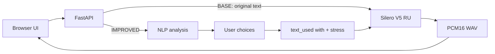

# Madrigal TTS

Локальный MVP для русской речи: сервис находит неоднозначные слова, даёт пользователю выбрать значение и передаёт выбранное ударение в Silero TTS. Результат — настоящий WAV, а не заглушка.

## Возможности

- FastAPI API и одностраничный интерфейс на HTML/CSS/JavaScript;
- BASE: исходный текст напрямую в Silero;
- IMPROVED: нормализация чисел, времени, годов и нескольких сокращений, выбор омографов и стресс-маркеры `+` для Silero;
- защита URL, e-mail, телефонов, версий и идентификаторов от преобразований;
- локальный расширяемый словарь произношений в `data/pronunciations.json`;
- Silero V5 RU, голос `xenia`, WAV mono PCM16/48 kHz, 300 мс цифровой тишины перед речью;
- безопасная выдача только файлов из `outputs/`, ограничение входа в 2000 символов.

## Архитектура



`text_used` формируется по `ambiguity_id` и исходным позициям справа налево. Например: `На двери висел замок` + `building` → `На двери висел з+амок`; вариант `lock` → `На двери висел зам+ок`. Защищённые фрагменты не становятся кандидатами и не изменяются.

## Структура

```text
app/main.py                 FastAPI и API
app/nlp_engine.py           нормализация и омографы
app/tts_engine.py           Silero и запись WAV
app/pronunciation_dictionary.py  JSON-словарь
app/static/                 интерфейс
data/pronunciations.json    локальные пользовательские варианты
models/V5_ru.pt             локальная модель (не публикуется)
tests/                      unit/API/integration tests
```

## Установка и запуск (Windows)

Проверенное окружение: Python 3.12. Модель и PyTorch намеренно не включены в Git.

```powershell
py -3.12 -m venv .venv
.\.venv\Scripts\Activate.ps1
python -m pip install -r requirements.txt
# Установите CPU PyTorch по официальному селектору pytorch.org
python -m uvicorn app.main:app --host 127.0.0.1 --port 8017
```

Откройте `http://127.0.0.1:8017/`; Swagger — `http://127.0.0.1:8017/docs`.

Скачайте русскую Silero V5-модель `v5_ru.pt` из официального каталога Silero и разместите её как `models/V5_ru.pt` (либо задайте `MADRIGAL_SILERO_MODEL_PATH`). Silero V5 RU распространяется по CC BY-NC 4.0: проверьте лицензию и условия атрибуции для своего сценария.

## API

- `GET /api/health`
- `POST /api/analyze` — `{"text":"На двери висел замок"}`
- `POST /api/synthesize` — `{"text":"...","mode":"base|improved","choices":{"amb_0":"building"}}`
- `GET /api/pronunciations`, `POST /api/pronunciations`, `PUT /api/pronunciations/{word}`, `DELETE /api/pronunciations/{word}`
- `GET /outputs/{filename}`

В IMPROVED невыбранная неоднозначность даёт `409`; неизвестный `option_id` — `422`. При отсутствии модели сервис отвечает честным `503`.

## Пользовательский словарь

Интерфейс сохраняет записи между перезапусками в `data/pronunciations.json`. Каждая запись имеет слово и один или больше вариантов: уникальный `id`, отображаемую форму, `meaning` и `tts_text` с ровно одним `+` перед ударной гласной. После сохранения запись сразу участвует в NLP-анализе. JSON записывается через временный файл с атомарной заменой.

## Проверки

```powershell
.\.venv\Scripts\python.exe -m pytest -q
```

Быстрые тесты используют mock Silero. Отдельно вручную проверялись локальный браузерный сценарий IMPROVED и реальная модель: WAV создаётся с 48 kHz, 16-bit PCM и 14 400 нулевыми сэмплами в начале. Побитовое различие WAV подтверждает разный вход, но не заменяет слуховую оценку человеком.

## Демонстрация на 3 минуты

1. Введите `На двери висел замок` и покажите BASE.
2. Нажмите «Проверить произношение», выберите «здание».
3. Запустите IMPROVED, покажите `text_used` в ответе API/диагностике, плеер и WAV.
4. Повторите с `В старом замке жил человек` и альтернативным значением.
5. Покажите время: `Встреча в 14:30`, а также URL/e-mail — они не изменяются.

## Ограничения и roadmap

NLP намеренно консервативен: не угадывает омографы без выбора, не покрывает все даты, дроби и сокращения. Длинные тексты пока передаются Silero одним запросом; очередь задач и очистка старых WAV — следующие production-задачи.

### Подтверждённые известные проблемы

- В текущем пользовательском сценарии AUTO может вернуть «Нужен выбор произношения» и потребовать ручной choice; это требует отдельной отладки перед демонстрацией.
- Названия режимов BASE, IMPROVED и AUTO ещё отображаются на английском.
- В длинном предложении про муку из пшеницы и «никакую муку» сейчас пользователь наблюдает только одно неоднозначное вхождение. Требуется ручная регрессия в живом интерфейсе и исправление, если проблема воспроизводится.
- Полноценная слуховая проверка качества и ударений человеком ещё не выполнена.
