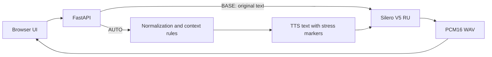

# Madrigal TTS

Локальный сервис синтеза русской речи на базе Silero V5 RU. Приложение предлагает два режима:

- **BASE** — передаёт исходный текст в Silero без NLP-преобразований.
- **AUTO** — автоматически нормализует поддерживаемые числовые конструкции и выбирает произношение известных омографов по контексту.

Ручной режим выбора произношения и пользовательский словарь удалены. Встроенный небольшой лексикон омографов остаётся частью алгоритма AUTO.

## Архитектура



## Возможности и ограничения AUTO

- Раздельная обработка каждого найденного вхождения омографа.
- Контекстные эвристики для встроенных омографов и некоторых словоформ: «замок», «мука», «атлас», «орган».
- Раскрытие поддерживаемых сокращений, нормализация времени и чисел.
- Годы 2000–2099 отображаются словесно; для AUTO годы 1000–2099 перед «году» также преобразуются в TTS-тексте. Для отдельных форм возможны ошибки морфологии.
- URL, e-mail, телефоны, версии и технические идентификаторы защищаются от преобразований.
- AUTO сообщает выбранный вариант и оценку уверенности. Это эвристика, а не гарантия правильного ударения.

AUTO работает полностью локально и детерминированно: внешний LLM/API не используется. Встроенный лексикон ограничен и не является полноценным морфологическим анализатором русского языка.

## Структура

```text
app/main.py                 FastAPI и API
app/schemas.py              Контракты BASE/AUTO
app/nlp_engine.py           Нормализация, омографы и AUTO
app/tts_engine.py           Silero и запись WAV
app/services/               Адаптеры NLP/TTS
app/static/                 HTML/CSS/JavaScript
models/V5_ru.pt             Локальная модель (не публикуется)
tests/                      Unit/API/regression tests
```

## Установка и запуск (Windows)

Требуется Python 3.12, совместимый CPU PyTorch и локальная модель Silero V5 RU.

```powershell
py -3.12 -m venv .venv
.\.venv\Scripts\Activate.ps1
python -m pip install -r requirements.txt
# Установите CPU PyTorch по официальному селектору pytorch.org
python -m uvicorn app.main:app --host 127.0.0.1 --port 8017
```

Поместите модель в `models/V5_ru.pt` либо задайте `MADRIGAL_SILERO_MODEL_PATH`. Откройте `http://127.0.0.1:8017/`; Swagger доступен по `/docs`.

## API

- `GET /api/health`
- `POST /api/analyze` — диагностический NLP-анализ.
- `POST /api/synthesize` — `{"text":"...","mode":"base|auto"}`
- `GET /outputs/{filename}` — безопасная выдача WAV.

BASE всегда передаёт исходную строку. AUTO возвращает `normalized_text` для отображения, `text_used` для TTS, `auto_decisions` и `warnings`.

## Проверки

```powershell
.\.venv\Scripts\python.exe -m pytest -q
```

Unit/API-тесты используют подмену синтезатора. Для оценки реального качества произношения необходима отдельная проверка с локальной моделью и прослушиванием человеком.

## Известные ограничения

- Встроенный список омографов и словоформ неполон.
- Контекстные правила не заменяют морфологический и синтаксический анализ; неоднозначные или редкие конструкции могут быть определены неверно.
- Нормализация чисел, дат, денежных сумм и единиц измерения пока покрывает не все формы.
- Качество ударений и естественность речи нужно проверять на реальном Silero, а не только тестами.
- Модель Silero V5 RU не хранится в Git; проверьте её лицензию и условия использования.
